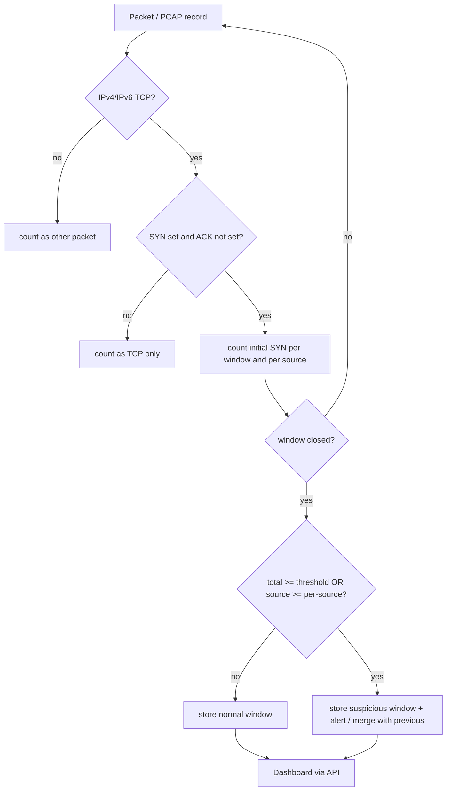

# System Architecture

## Block diagram
```
 +-------------------+     +------------------------+     +-------------------+
 | Live NIC (Scapy)  |     | Simulation generator   |     | Uploaded PCAP     |
 +---------+---------+     | (synthetic metadata)   |     +---------+---------+
           |               +-----------+------------+               |
           v                           v                            v
   +-------------------------------------------+        +---------------------+
   | MonitorManager (background thread, 1 only)|        | pcap_reader +       |
   +--------------------+----------------------+        | pcap_analyzer       |
                        v                               +----------+----------+
               +------------------+                                |
               |   SynDetector    |<-------------------------------+
               | (time windows,   |
               |  per-source)     |
               +--------+---------+
                        | finished window
                        v
               +------------------+        +----------------------+
               |  AlertManager    |------->|  SQLite (db_manager) |
               | (de-duplication) |        | sessions/windows/    |
               +------------------+        | alerts               |
                                           +----------+-----------+
                                                      |
               +--------------------------------------v-----------+
               | Flask (app.py)  REST API  /api/*                 |
               +--------------------------------------+-----------+
                                                      | JSON every 2 s
                                     +----------------v-----------------+
                                     | Browser dashboard (HTML/CSS/JS,  |
                                     | Chart.js)                        |
                                     +----------------------------------+
```

## Workflow (Mermaid)


## Module roles
- **syn_detector.py** - pure logic, no Flask/Scapy: easy to test.
- **packet_capture.py** - owns the single worker thread; `start()` refuses a second worker (HTTP 409).
- **pcap_reader.py** - parses classic PCAP and PCAPNG; Ethernet, VLAN, raw IP, Linux cooked, loopback.
- **alert_manager.py** - merges consecutive suspicious windows into one alert.
- **db_manager.py** - three tables: `sessions`, `windows`, `alerts`.
